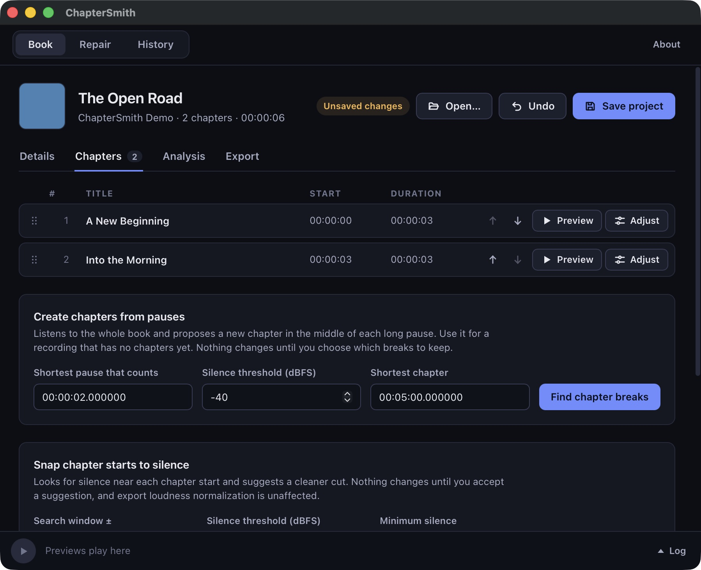
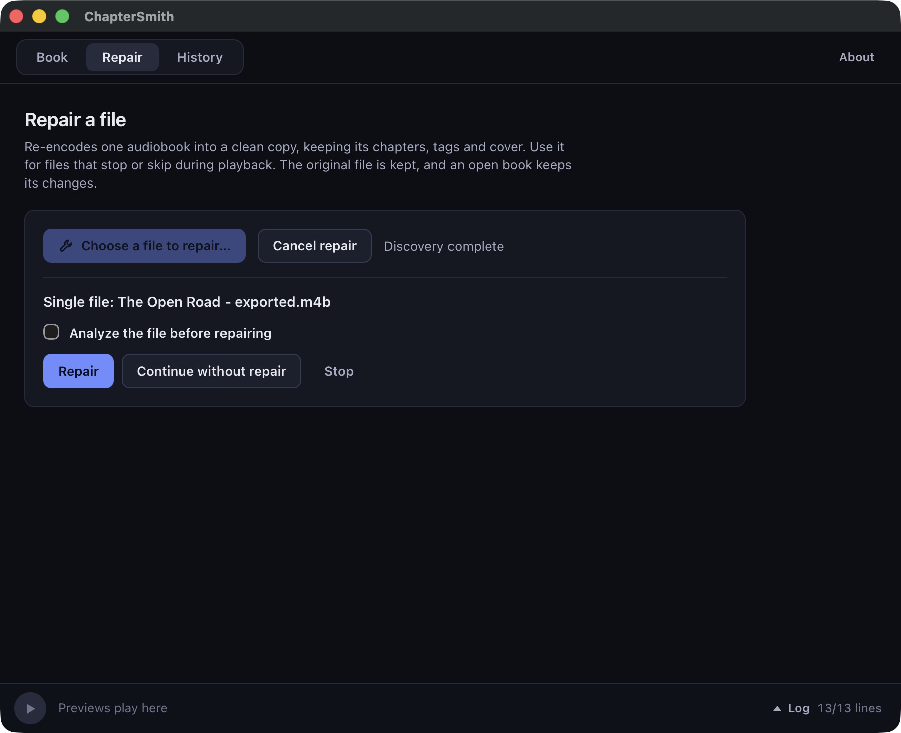

<p align="center">
  
</p>

<h1 align="center">ChapterSmith</h1>

<p align="center">
  <strong>Your audiobook. Your chapters. Ready for your next listen.</strong>
</p>

<p align="center">
  A desktop audiobook editor, repair tool, and command-line merger.<br />
  Built for macOS, Windows, and Linux. Your audio stays on your computer.
</p>

<p align="center">
  <a href="LICENSE"></a>
  
  
</p>

<p align="center">
  <a href="https://github.com/ChapterSmith/chaptersmith/releases/tag/v1.0.0"><strong>Download v1.0.0</strong></a>
  · <a href="#book--import-edit-listen-export">Book</a>
  · <a href="#repair--rebuild-an-existing-audiobook">Repair</a>
  · <a href="#use-the-cli">CLI</a>
  · <a href="https://github.com/ChapterSmith/chaptersmith/issues">Report a bug</a>
</p>

---

An audiobook should feel like one book, even when it arrives as dozens of tracks. ChapterSmith gives you a workspace to arrange chapters, edit tags and artwork, listen to previews, and export a book that is ready for your player.

**Book** is for editing and exporting. **Repair** rebuilds a single original audio file as a fresh M4B. Everything runs locally, and your source recordings stay untouched.



<p align="center"><em>The Book workspace. Screenshots use synthetic demonstration audio.</em></p>

## Your book, from loose tracks to a finished audiobook

| Feature | What you can do |
| --- | --- |
| **Flexible import** | Open a folder or a single MP3, M4A, M4B, AAC, OGG, Opus, FLAC or WAV file. Use M3U/M3U8 playlists and CUE sheets. |
| **Chapter editor** | Rename and reorder chapters, adjust boundaries, split or merge sections, and manage pauses between chapters. |
| **Details and artwork** | Edit supported metadata, keep additional tags, and choose or remove a cover. |
| **Preview player** | Listen to chapters and proposed boundary changes before exporting. |
| **Audio analysis** | Review possible repetitions, clipping, long quiet passages, decoding errors and timestamp problems. Audition findings where a preview is available. |
| **Export choices** | Create one audiobook, individual chapter files, or both. Choose M4B, M4A, FLAC or WAV, quality and channel settings. |
| **Loudness normalization** | Optionally apply one constant gain across the whole book, targeting −18 LUFS while respecting a −2 dBTP ceiling. |
| **Repair / Fix** | Re-encode a readable original file into a new M4B with supported chapters, metadata and artwork. |
| **Saved projects** | Return to your edits later, undo changes, and inspect export and repair history. |

## Book — import, edit, listen, export

1. In **Book**, choose **Open folder** for a collection of tracks or **Open audio file** for an existing audiobook. Expand **Import options** to select a playlist, CUE sheet or chapter source explicitly.
2. In **Details**, update the title, author and other tags, then choose the cover you want.
3. In **Chapters**, review the order and names, adjust boundaries, split or merge chapters, and preview your changes in the player at the bottom of the window. Silence tools offer proposals for you to review.
4. Optionally run **Analyze audio** in **Analysis**. Findings are diagnostic; analysis does not silently edit your book.
5. In **Export**, select the format, quality and output layout, then **Choose destination and export**.

Use **Save project** to keep your editing state. Projects refer to the source audio, so keep those files available when reopening a project.

```text
My Audiobook/
├── 01 - A New Beginning.mp3
├── 02 - Into the Morning.mp3
└── 03 - The Long Way Home.mp3
             ↓ import · edit · preview · export
My finished book/
├── book.m4b
└── chapters/             optional individual chapter files
```

Playlist order and repeated entries are preserved. Without a playlist or CUE ordering, tracks follow natural filename order — track 2 before track 10. Ambiguous sidecar selections ask you to choose explicitly.

**Preserve original audio** copies compatible AAC only when the edits and export settings allow it; otherwise ChapterSmith reports a re-encoding fallback. FLAC and WAV output cannot restore detail that was already lost in a lossy source.

## Repair — rebuild an existing audiobook

Repair, also available as `-fix` in the CLI, is for a book that is **already one file**. It decodes and re-encodes the original audio into a fresh M4B, carrying over supported chapter markers, metadata and artwork.



1. Open **Repair** and choose **Choose a file to repair…**. If the open book has one source file, you can select that original directly.
2. Choose a **different output filename**, such as `My Audiobook - repaired.m4b`.
3. Select **Repair**. Optionally check **Analyze the file before repairing** to inspect a report first.
4. If you requested analysis, review or audition the findings, then choose **Continue repair** or cancel.

| Choice | What happens |
| --- | --- |
| **Repair** | Re-encodes the original file and builds a fresh M4B. |
| **Continue without repair** | Uses normal processing, allowing compatible AAC to avoid re-encoding. |
| **Stop** | Ends the operation without processing the file. |

Repair uses the **original source**, so edits made in Book are not included in the repaired copy. Use Book → Export to render those edits. Embedded chapters take priority in Fix mode; when absent, a CUE sheet can supply chapters.

Repair can help with a readable stream or container that a player handles poorly. It does **not** remove repetitions, recover missing samples, remove DRM, or reliably undo clipping. Re-encoding is lossy. Keep the original and compare the result.

### Follow the work

The interface shows progress and offers cancellation during active operations. The bottom **Log** drawer has **Simple** and **Full** views. **History** keeps earlier exports and repairs with their logs on your computer. **About** shows the application's version and build time.

## Download and install

Get the package for your system from the [v1.0.0 release](https://github.com/ChapterSmith/chaptersmith/releases/tag/v1.0.0). Desktop and CLI packages are separate; install whichever you need.

| System | Architecture | Desktop app | CLI |
| --- | --- | --- | --- |
| macOS 13 or newer | Apple Silicon (`arm64`) or Intel (`x64`) | `.dmg` | `.pkg` |
| Windows | Intel/AMD 64-bit (`x64`) | `ChapterSmith-…-setup.exe` | `ChapterSmith-CLI-…-setup.exe` |
| Linux | `x86_64` or `aarch64` | `ChapterSmith-….AppImage` | `ChapterSmith-CLI-….AppImage` |

**Signing status:** macOS packages have no Apple Developer ID signature or notarization, and Windows installers are not code-signed. Your operating system may block or warn about these downloads. Download from this repository's releases and verify the published SHA-256 checksums.

- **macOS:** open the DMG and drag ChapterSmith to Applications. The separate CLI installer adds `chaptersmith` to `/usr/local/bin`.
- **Windows:** run the desktop or CLI installer. The desktop installer checks for Microsoft WebView2 and downloads it if needed; that step requires an internet connection. The CLI installer adds its directory to your user PATH. Open a new terminal after installation.
- **Linux:** make the AppImage executable with `chmod +x filename.AppImage`, then run it. The GUI uses system GTK 3 and WebKitGTK 4.1; on Ubuntu 22.04 install `libgtk-3-0` and `libwebkit2gtk-4.1-0`. On systems without FUSE, launch with `APPIMAGE_EXTRACT_AND_RUN=1`.

FFmpeg is included in the packages; a separate FFmpeg installation is not needed.

## Use the CLI

Run ChapterSmith from the directory containing your audiobook tracks:

```sh
cd "/path/to/My Audiobook"
chaptersmith -o "My Audiobook.m4b"
```

Without `-o`, the output defaults to the current folder's name with an `.m4b` extension. The CLI writes `chaptersmith.log` in that folder.

```sh
chaptersmith -version
chaptersmith -h
chaptersmith -playlist "reading-order.m3u8" -o "My Audiobook.m4b"
chaptersmith -cue "chapters.cue" -o "My Audiobook.m4b"
chaptersmith -chapter-source embedded -o "My Audiobook.m4b"
chaptersmith -fix -o "repaired.m4b"
```

For `-fix`, use a folder containing one source audio file. Press `Ctrl+C` to cancel. The desktop Book editor's project and export controls are separate from the CLI's merge and Fix workflow.

## File handling and limitations

- Folder discovery reads files directly in the selected folder; it does not recursively scan subfolders.
- M3U, M3U8 and CUE extensions are recognized without regard to case. If several sidecars match, choose one explicitly instead of relying on an arbitrary first match.
- DRM-protected audiobooks are not supported. Supported metadata is preserved; not every possible tag or container feature can be carried over.
- Audio analysis flags candidates for review. A finding is not proof of damage, and a clean report does not guarantee a fault-free recording.
- FLAC/WAV books do not contain the full M4B chapter table. WAV output does not store cover artwork.
- Preserving compatible AAC can retain encoder padding at joins; fully gapless playback is not guaranteed.
- Book export writes to a new output location. Repair rejects an output that would overwrite its input. Choose a new filename when you want to retain an earlier CLI or Repair export.

## Build from source

The project uses Go, Wails v3, a Vite frontend, and statically linked LGPL FFmpeg n8.0 libraries.

You need Go 1.27+, Node.js with npm, Python 3, Git, Make, a C/C++ compiler, and `pkg-config`. Install NASM on x86-64 systems. Linux additionally needs zlib development headers, GTK 3 development headers, and WebKitGTK 4.1 development headers. On Windows, use an MSYS2 UCRT64 shell and its GCC, pkgconf, zlib, and ntldd packages.

```sh
git clone https://github.com/ChapterSmith/chaptersmith.git
cd chaptersmith
make ffmpeg
make build
make build-gui
make test
npm --prefix frontend test
```

Builds are written to `dist/`. On macOS, `make build-gui` also creates `dist/ChapterSmith.app`. `make test` runs the Go tests with the race detector.

`make package` creates the platform's desktop and CLI packages. Packaging additionally requires `appimagetool` on Linux or NSIS on Windows. The [GitHub Actions workflow](.github/workflows/release.yml) contains the complete setup for all five platform/architecture combinations.

### Rebuild a release with modified FFmpeg

Download the platform-specific `ChapterSmith-VERSION-REVISION-PLATFORM-sources.tar.gz` and its adjacent `.sha256` file. The archive contains the matching application source, FFmpeg source, pinned dependency manifests, and build configuration. Python 3 is required for verification and extraction.

From a ChapterSmith checkout, verify and extract the downloaded archive into an empty directory:

```sh
python3 scripts/source-release.py extract /path/to/ChapterSmith-VERSION-REVISION-PLATFORM-sources.tar.gz /tmp/chaptersmith-rebuild
cd /tmp/chaptersmith-rebuild/app
```

Make your compatible changes in `../ffmpeg`, then rebuild the libraries and both applications:

```sh
go mod download
npm --prefix frontend ci
bash scripts/build-ffmpeg.sh --source-dir ../ffmpeg --prefix "$PWD/vendor/ffmpeg"
make VERSION=local-rebuild build build-gui
```

The binaries are written to `dist/`. No private signing keys are required. On macOS, a local ad-hoc signature can be applied with `codesign --force --deep --sign - dist/ChapterSmith.app`; this is not Developer ID signing or notarization. See `dependencies/BUILDING-FFMPEG.txt` in the extracted archive for the release's FFmpeg configuration. Dependency downloads require network access.

## Report a problem

[Open an issue](https://github.com/ChapterSmith/chaptersmith/issues) with your operating system, architecture, version and build time from **About**, input formats, and steps to reproduce. Include a relevant log excerpt after removing private paths and metadata. Share audio samples only if you have permission to distribute them.

## License and dependencies

ChapterSmith's original code is licensed under the [MIT License](LICENSE). Personal and commercial use are both allowed, subject to that license.

FFmpeg is a separate dependency licensed under **LGPL 2.1 or later**. ChapterSmith's MIT license does not replace or restrict FFmpeg's license. Packages use statically linked FFmpeg libraries built without GPL or nonfree components and include dependency notices. Each release provides the corresponding source and rebuilding archives for replacing the LGPL libraries.

See the [FFmpeg notice](licenses/FFMPEG-NOTICE.txt), [LGPL text](licenses/LGPL-2.1.txt), and [zlib notice](licenses/ZLIB-NOTICE.txt). Other dependencies retain their own licenses, included in the packaged notices.
